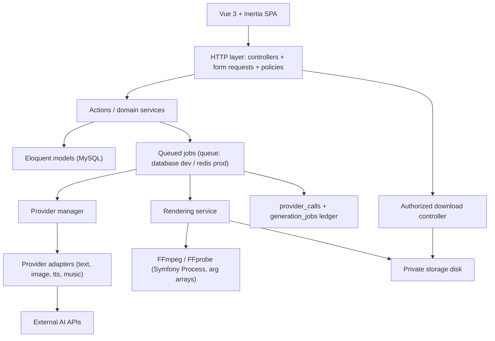
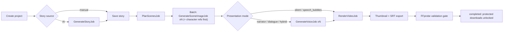

# Architecture

> Canonical technical structure. Layer boundaries are binding; internal file names are established by implementation (do not invent paths that don't exist — see [DEVELOPMENT_RULES.md](DEVELOPMENT_RULES.md)).

## Stack recap

PHP 8.3+ / Laravel 13 / MySQL / Vue 3 + Inertia.js / Tailwind CSS 4 / JavaScript only / Vite / Laravel Queue (database driver local, Redis production) / FFmpeg + FFprobe / private asset storage. Full environment facts: [ENVIRONMENT_SETUP.md](ENVIRONMENT_SETUP.md).

## Layers and responsibilities

| Layer | Responsibility | Must not |
|---|---|---|
| HTTP (controllers + form requests) | Validate input, authorize, call actions/services, return Inertia responses | Run rendering or provider calls synchronously; expose secrets in props |
| Actions / domain services | Business logic: story assembly, duration validation, scene planning orchestration, render pre-flight | Contain provider-specific HTTP logic; touch FFmpeg directly |
| Provider contracts + adapters | All provider-specific request/response/error logic per capability | Leak into business logic (see [PROVIDER_INTEGRATION.md](PROVIDER_INTEGRATION.md)) |
| Provider manager/registry | Resolve capability → configured provider honoring defaults + per-project overrides | |
| Queued jobs | One concern each (story, plan, character ref, scene image, voice, render, thumbnail); update `generation_jobs` status/progress | Retry infinitely; double-charge providers |
| Rendering service | Build FFmpeg/FFprobe invocations via Symfony Process with argument arrays | Concatenate user input into shell strings |
| Asset storage | Private disk for all generated artifacts | Serve generated media from `public/` |
| Authorization (policies) | Ownership checks on every project/scene/asset/job operation | Rely on hidden URLs alone |

## Core workflow (job orchestration)

Rules encoded above:
- Character reference images are generated **before** scene images that use them.
- Silent and speech-bubble modes skip all audio jobs entirely.
- Every job records status/progress/attempts in `generation_jobs` and provider usage in `provider_calls` ([DATABASE_DESIGN.md](DATABASE_DESIGN.md)).
- Failed scenes retry individually; intact assets are never regenerated on retry (idempotency, [COST_MANAGEMENT.md](COST_MANAGEMENT.md)).

## Queue strategy

- **Local development (Windows):** `QUEUE_CONNECTION=database` with `jobs/job_batches/failed_jobs` tables. Runs via one or more `php artisan queue:work` processes. Horizon is NOT usable on Windows (no `pcntl`) — it is an optional production extra, not a dependency.
- **Production:** Redis + Supervisor-managed workers. Queues: `render` (heavy, serialized), `media` (images/TTS), `default` (story/plan/thumbnail). Documented in [DEPLOYMENT.md](DEPLOYMENT.md).
- Backoff: exponential with retry caps per job type; failed jobs recorded with actionable messages; no internal traces to UI ([SECURITY.md](SECURITY.md)).

## Storage

- All generated media (images, audio, video, thumbnails, SRT) on a **private disk** (e.g., a configured non-public storage location), served only via authorized download endpoints. Uploads validated. Rationale and rules: [SECURITY.md](SECURITY.md).

## Rendering service boundary

The renderer owns: pre-flight validation, per-scene FFmpeg segment builds, transitions, audio graph, final mux, FFprobe gate, thumbnail, SRT, and intermediate-file cleanup. Complete specification: [VIDEO_RENDERING.md](VIDEO_RENDERING.md).

## Future SaaS boundaries (documented, NOT implemented)

Seams reserved now: `user_id` ownership on all rows; nullable `owner_user_id` on `provider_settings` for per-user keys; usage metering already captured in `provider_calls` (future credit deduction reads this ledger); no billing code, no workspace tables yet. When SaaS arrives, add a tenancy layer around these seams rather than rewriting them.
