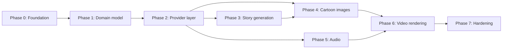

# Implementation Plan

> Phase overview with dependencies. Per-phase detail lives in `phases/`. Acceptance criteria consolidated in [reference/ACCEPTANCE_CRITERIA.md](reference/ACCEPTANCE_CRITERIA.md).

## Dependency graph

Phase 5 can start after Phase 2 in parallel with 3/4, but Phase 6 requires scene images (4) and audio states (5) to render correctly.

## Phase summaries

| Phase | Goal | Doc |
|---|---|---|
| 0 | Laravel 13 + Inertia/Vue3/Tailwind4 (JS-only) scaffold, MySQL, queue tables, FFmpeg config, auth | [PHASE_00_FOUNDATION.md](phases/PHASE_00_FOUNDATION.md) |
| 1 | Migrations, models, policies, project/story/scene/character CRUD + storyboard UI, duration validation | [PHASE_01_DOMAIN_MODEL.md](phases/PHASE_01_DOMAIN_MODEL.md) |
| 2 | Provider contracts, manager, encrypted credentials, config UI, ledger, fakes | [PHASE_02_PROVIDER_LAYER.md](phases/PHASE_02_PROVIDER_LAYER.md) |
| 3 | Story generation + scene planning jobs (real provider after doc verification) | [PHASE_03_STORY_GENERATION.md](phases/PHASE_03_STORY_GENERATION.md) |
| 4 | Character reference + scene image generation, per-scene regenerate, status UI | [PHASE_04_CARTOON_IMAGES.md](phases/PHASE_04_CARTOON_IMAGES.md) |
| 5 | TTS narration/dialogue, licence gate, uploads, silent mode | [PHASE_05_AUDIO.md](phases/PHASE_05_AUDIO.md) |
| 6 | FFmpeg render pipeline, ffprobe gate, thumbnail, SRT, protected downloads | [PHASE_06_VIDEO_RENDERING.md](phases/PHASE_06_VIDEO_RENDERING.md) |
| 7 | Error recovery UX, cost controls, docs, deployment hardening | [PHASE_07_HARDENING.md](phases/PHASE_07_HARDENING.md) |

## Working agreement per phase

1. Read the phase doc + its references (per [INDEX.md](INDEX.md) lookup table).
2. Implement in small verifiable steps; run tests/build after each step.
3. Complete **all** acceptance criteria; collect evidence (commands + results).
4. Update the phase doc status, [PROGRESS.md](PROGRESS.md), [CHANGELOG.md](CHANGELOG.md), and any affected reference docs.
5. Report changed files, test results, failures, outstanding issues.

## External blockers & gating decisions

| Blocker | Affects | Resolution path |
|---|---|---|
| FFmpeg/FFprobe not installed | Phase 6 (pipelines earlier if experimenting) | Install per [ENVIRONMENT_SETUP.md](ENVIRONMENT_SETUP.md) |
| API credentials (text/image/TTS) | Phase 3+ real-provider runs | User supplies keys after provider selection (D-007, [reference/API_RESEARCH.md](reference/API_RESEARCH.md)) |
| Provider doc verification | Phases 3–5 adapter code | Research step inside each phase; record in API_RESEARCH + DECISIONS |

Nothing in Phases 0–2 requires API keys; the fake-provider layer (Phase 2) keeps the full pipeline testable without paid calls.

## Out of scope for ALL phases (MVP)

Automated social publishing; subscription billing; public registration; per-user key UI; AI video clips. See [MVP_SCOPE.md](MVP_SCOPE.md).
