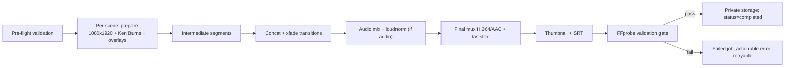

# Video Rendering

> Complete specification of the FFmpeg/FFmpeg-adjacent pipeline. Renderer owns all media assembly. Nothing here runs in an HTTP request.

## Pipeline (ordered, each step verifiable)

1. **Pre-flight validation** — project in renderable state; every scene `status=ready` with an existing image asset on disk; Σ scene durations within tolerance of target (30–90 s); audio assets present for all narration/dialogue when mode requires them; music/SFX pass the licence gate (`licence_verified=true`).
2. **Prepare scene images** — scale/pad/crop each still to exact 1080×1920 (cover-crop, preserving composition).
3. **Animate (Ken Burns)** — per-scene slow zoom/pan via `zoompan` at consistent 30 fps for the scene's exact duration; deterministic parameters derived from scene number (alternate direction) so renders are reproducible.
4. **Overlays** — speech bubbles (mode `speech_bubbles`/`hybrid` bubble settings): pre-rendered PNG overlays (text wrapped server-side, positioned per `speech_bubble_settings`); burned-in captions optional per project settings.
5. **Scene segments** — render each scene to an intermediate H.264 yuv420p segment (uniform fps/SAR/PixFmt) so concat is lossless-safe.
6. **Transitions** — join segments with short `xfade` transitions (e.g., crossfade); transition time is included in scene duration budget, not additive.
7. **Audio graph** — place narration/dialogue audio at scene-relative offsets (`adelay`), mix (`amix`), optional music bed at low volume with ducking under speech, optional SFX.
8. **Loudness normalization** — `loudnorm` on the mixed program audio when audio exists.
9. **Final encode** — H.264 (yuv420p), AAC, 1080×1920, 30 fps, `+faststart`; target duration = Σ scene durations.
10. **Thumbnail** — extract a representative frame (default: a chosen scene, else first) as an image asset.
11. **SRT export** — when narration/dialogue timing data supports it; cues derived from scene durations and audio durations; stored as a subtitle asset.
12. **FFprobe validation gate** — verify container/codec (h264/aac), resolution 1080×1920, fps, duration within tolerance, audio stream presence iff audio enabled, non-zero size. Failure ⇒ job failed, artifact quarantined/not offered.
13. **Publish privately** — move final artifacts to the private disk under the project; set `projects.status=completed`; unlock authorized downloads. Never in `public/`.

## Safe process execution (hard rule)

- Symfony Process with **array arguments** only. Never `FromShellCommandline`, never string concatenation of story text, prompts, filenames, or paths into a command string.
- All paths computed from sanitized identifiers; user text reaches FFmpeg only via input files (e.g., captions/bubble text pre-rendered to PNG or passed via `drawtext` with strict escaping — prefer pre-rendered PNG).
- Explicit timeouts on every process (env-configurable, e.g., `FFMPEG_TIMEOUT_SECONDS`); on timeout, kill the process tree, mark job failed, clean intermediates.
- FFmpeg/FFprobe binary locations from config/env (`FFMPEG_BINARY`, `FFPROBE_BINARY`) — never assumed on PATH (this machine does not have them — [ENVIRONMENT_SETUP.md](ENVIRONMENT_SETUP.md)).

## Reliability requirements

| Concern | Requirement |
|---|---|
| Recoverability | Per-scene retries and render retries must not regenerate intact upstream assets (images/audio stay; only failed stage reruns) |
| Progress | Render job reports granular progress (per scene, per stage) to `generation_jobs.progress` |
| Cleanup | Intermediate segments/temp files removed on success AND failure; intermediates live on a temp area, never the asset disk |
| Duplicate renders | A project renders one video at a time (lock); stale `rendering` status recoverable by a sweep |
| Failure evidence | ffprobe/ffmpeg stderr tail (redacted) stored in the job record for diagnosis, not shown raw to UI |
| Disk safety | Pre-flight checks free space before starting; artifacts checksummed in `assets.meta` |

## Output contract (enforced by the validation gate)

MP4 / H.264 yuv420p / AAC (iff audio enabled) / 1080×1920 / 30 fps / 30–90 s / `+faststart` / no black first frame (validated via extracted first-frame check during gate) / normalized loudness when audio present.

Related: provider-generated visual strategy [PROJECT_OVERVIEW.md](PROJECT_OVERVIEW.md); asset storage rules [SECURITY.md](SECURITY.md); test approach for command construction [TESTING_STRATEGY.md](TESTING_STRATEGY.md).
