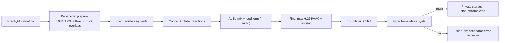

# Video Rendering

> Complete specification of the FFmpeg/FFmpeg-adjacent pipeline. Renderer owns all media assembly. Nothing here runs in an HTTP request.

## Pipeline (ordered, each step verifiable)

1. **Pre-flight validation** — project in renderable state; every scene `status=ready` with an existing image asset on disk; Σ scene durations within tolerance of target (30–90 s); audio assets present for all narration/dialogue when mode requires them; music/SFX pass the licence gate (`licence_verified=true`).
2. **Prepare scene images** — scale/pad/crop each still to exact 1080×1920 (cover-crop, preserving composition).
3. **Animate (Ken Burns)** — per-scene slow zoom/pan via `zoompan` at consistent 30 fps for the scene's exact duration; deterministic parameters derived from scene number (alternate direction) so renders are reproducible.
4. **Overlays** — speech bubbles (mode `speech_bubbles`/`hybrid` bubble settings): pre-rendered PNG overlays (text wrapped server-side, positioned per `speech_bubble_settings`); burned-in captions optional per project settings.
5. **Scene segments** — render each scene to an intermediate H.264 yuv420p segment (uniform fps/SAR/PixFmt) so concat is lossless-safe.
6. **Transitions** — join segments with short `xfade` transitions (e.g., crossfade); transition time is included in scene duration budget, not additive.
7. **Audio graph** — place narration/dialogue audio at scene-relative offsets (`adelay`), mix (`amix`), optional music bed at low volume with ducking under speech, optional SFX.
8. **Loudness normalization** — `loudnorm` on the mixed program audio when audio exists.
9. **Final encode** — H.264 (yuv420p), AAC, 1080×1920, 30 fps, `+faststart`; target duration = Σ scene durations.
10. **Thumbnail** — extract a representative frame (default: a chosen scene, else first) as an image asset.
11. **SRT export** — when narration/dialogue timing data supports it; cues derived from scene durations and audio durations; stored as a subtitle asset.
12. **FFprobe validation gate** — verify container/codec (h264/aac), resolution 1080×1920, fps, duration within tolerance, audio stream presence iff audio enabled, non-zero size. Failure ⇒ job failed, artifact quarantined/not offered.
13. **Publish privately** — move final artifacts to the private disk under the project; set `projects.status=completed`; unlock authorized downloads. Never in `public/`.

## As-built notes (Phase 6, 2026-10-28)

The pipeline is implemented exactly as specified above. Concrete details for operators and future maintainers:

- **Services** (`App\Services\Render\`): `RenderPlanBuilder` (pre-flight, step 1), `BubbleOverlayRenderer` (step 4), `FfmpegRenderer` (steps 2–5, 7–9), `FfmpegCommandBuilder` (pure argument arrays), `FfprobeGate` (steps 12), `SrtBuilder` (step 11), `RenderArtifactPublisher` (step 13), `RenderOrchestrator` (wiring + cleanup + progress), `BinaryProbe` (R-5 health check incl. codec presence), `ProcessRunner`/`SymfonyProcessRunner` (safe execution), `StderrRedactor`, `LocalStoragePaths` (trusted-disk path resolution with realpath containment), `RenderSettings` (contract constants 1080×1920/30 fps/yuv420p + env-tunable knobs), `RenderTimeline`/`RenderTimelineCue` (single timing source, D-029), `BubbleFontResolver`.
- **Per-scene segment filter** (steps 2–5, one ffmpeg invocation per scene):
  `[0:v]scale=2160:3840:force_original_aspect_ratio=increase,crop=2160:3840,zoompan=z='<expr>':x='<expr>':y='<expr>':d={frames}:s=1080x1920:fps=30,setsar=1,format=yuv420p[v]`
  Stills are cover-scaled to a 2160×3840 canvas (2× the output) so zoompan pans without upscaling; `frames = round(len × 30)`; Ken Burns expressions derive from the scene number only (even scenes zoom in centered, odd zoom out; every 4th scene pans horizontally/vertically — deterministic and reproducible). Speech-bubble PNGs (full-canvas transparent, GD-rendered) are chained as extra inputs via `;[{i}:v]format=rgba[bub{i}];{prev}[bub{i}]overlay=0:0:format=auto{next}`. Encoding: `-c:v libx264 -preset {FFMPEG_X264_PRESET} -crf {FFMPEG_CRF} -pix_fmt yuv420p -r 30 -frames:v {frames}`.
- **Final mux** (steps 6–9, one ffmpeg invocation): segment inputs + audio inputs; video chain `[0:v][1:v]xfade=transition=fade:duration=0.500:offset={Σd_1..k}[x1];…` — transition k starts exactly where scene k's content ends (`offset_k = Σ_{j≤k} d_j`), segments k<N carry `+0.5 s` so the final duration stays exactly Σ scene durations (transitions are inside the budget, never additive). Audio graph: speech (`[i:a]aresample=48000,aformat=sample_fmts=fltp:channel_layouts=stereo,adelay={ms}:all=1[spN]`) → `amix=inputs=N:normalize=0[mixs]`; music beds (`-stream_loop -1` + `volume=0.250` + `atrim=start=0:end={total},asetpts=PTS-STARTPTS`) → `[mixm]`; ducking `[mixs]asplit=2[sc][mixs2];[mixm][sc]sidechaincompress=threshold=0.02:ratio=8:attack=30:release=400[mduck];[mixs2][mduck]amix=inputs=2:normalize=0:duration=longest[pre]`; program `[pre]loudnorm=I=-16:TP=-1.5:LRA=11,aresample=48000[a]`; output `-c:v libx264 … -c:a aac -b:a 192k -ar 48000 -movflags +faststart -t {Σd}`. Silent plans map `[v]` only with `-an` (video-only MP4, verified by the gate).
- **Gate** (step 12): ffprobe `-print_format json -show_format -show_streams`; contract = MP4 container, size > 0, duration within ±`FFMPEG_GATE_DURATION_TOLERANCE` of Σd, h264/1080×1920/30 fps/yuv420p, AAC iff audio enabled (and NO audio stream when silent), `+faststart` verified by an exact MP4 top-level box walk (moov before mdat), first frame non-black via GD average luminance ≥ `FFMPEG_GATE_MAX_BLACKNESS`. Failure ⇒ job failed with the specific violations in `result.gate_violations` and the artifact moved to `renders/{project}/quarantine/` (never offered; sweep removes files older than 24 h).
- **Timing/placement (D-029)**: narration first inside a scene, then dialogue lines in `sort_order`; each item starts when the previous measured item ends; unknown durations contribute 0 (warning recorded, cue skipped in SRT). Audio overrunning its scene is a user-visible warning (R-10), not a block. SFX assets have no placement metadata yet — they enter the program layer from t=0 (documented limitation).
- **Status flow**: pre-flight passes → `projects.status=rendering` → success `completed` (publisher) / execution failure `failed` unless a previous completed video exists (a failed re-render never hides the old render) / pre-flight failure leaves the status untouched.
- **Downloads**: `assets.show` (policy-checked) serves all artifacts; `?download=1` switches to `Content-Disposition: attachment` for explicit downloads. Nothing is ever exposed from `public/`.

## Safe process execution (hard rule)

- Symfony Process with **array arguments** only. Never `FromShellCommandline`, never string concatenation of story text, prompts, filenames, or paths into a command string.
- All paths computed from sanitized identifiers; user text reaches FFmpeg only via input files (e.g., captions/bubble text pre-rendered to PNG or passed via `drawtext` with strict escaping — prefer pre-rendered PNG).
- Explicit timeouts on every process (env-configurable, e.g., `FFMPEG_TIMEOUT_SECONDS`); on timeout, kill the process tree, mark job failed, clean intermediates.
- FFmpeg/FFprobe binary locations from config/env (`FFMPEG_BINARY`, `FFPROBE_BINARY`) — never assumed on PATH (this machine does not have them — [ENVIRONMENT_SETUP.md](ENVIRONMENT_SETUP.md)).

## Reliability requirements

| Concern | Requirement |
|---|---|
| Recoverability | Per-scene retries and render retries must not regenerate intact upstream assets (images/audio stay; only failed stage reruns) |
| Progress | Render job reports granular progress (per scene, per stage) to `generation_jobs.progress` |
| Cleanup | Intermediate segments/temp files removed on success AND failure; intermediates live on a temp area, never the asset disk |
| Duplicate renders | A project renders one video at a time (lock); stale `rendering` status recoverable by a sweep |
| Failure evidence | ffprobe/ffmpeg stderr tail (redacted) stored in the job record for diagnosis, not shown raw to UI |
| Disk safety | Pre-flight checks free space before starting; artifacts checksummed in `assets.meta` |

## Output contract (enforced by the validation gate)

MP4 / H.264 yuv420p / AAC (iff audio enabled) / 1080×1920 / 30 fps / 30–90 s / `+faststart` / no black first frame (validated via extracted first-frame check during gate) / normalized loudness when audio present.

Related: provider-generated visual strategy [PROJECT_OVERVIEW.md](PROJECT_OVERVIEW.md); asset storage rules [SECURITY.md](SECURITY.md); test approach for command construction [TESTING_STRATEGY.md](TESTING_STRATEGY.md).
